# Laboratorios — Maratón de Series

## 1. Montaje del proyecto (React + Bootstrap)

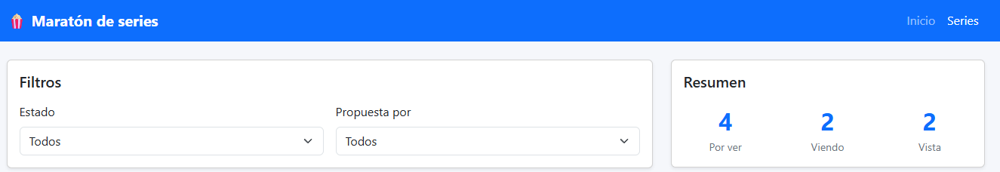

## 2. Componentes: armar el tablero

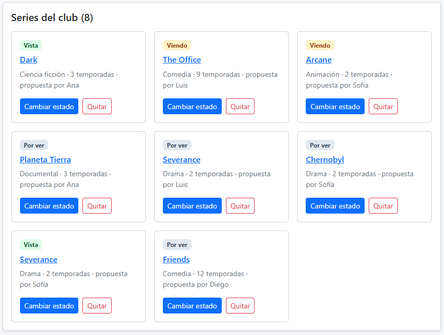

### Componentes y props

| Componente | Props | ¿Qué hace? |
|---|---|---|
| `Encabezado` | Ninguna | Muestra la barra superior. |
| `Pagina` | `children` | Organiza la página y su contenido. |
| `Panel` | `titulo`, `children` | Muestra un panel con título y contenido. |
| `TarjetaSerie` | `serie`, `onAvanzar`, `onQuitar` | Muestra una serie y sus botones. |
| `ListaSeries` | `series`, `onAvanzar`, `onQuitar` | Recorre las series y genera sus tarjetas. |

### Preguntas guía

**1. ¿De dónde sale `children` en Pagina y Panel?**

Del contenido que se coloca entre las etiquetas de apertura y cierre del componente.

**2. ¿Qué sucede al hacer clic en Cambiar estado?**

La tarjeta ejecuta `onAvanzar` con el identificador de la serie. No modifica los datos directamente, sino que avisa al componente padre.

**3. ¿Qué muestra ListaSeries si el arreglo está vacío? ¿Qué se utiliza como key?**

Muestra el mensaje de lista vacía. En la versión inicial se utiliza `serie.id` como `key`; posteriormente se cambia a `serie._id` al integrar MongoDB.

**4. ¿Qué recibe ListaSeries que solamente pasa a TarjetaSerie?**

Las funciones `onAvanzar` y `onQuitar`.

## 3. ¿Por qué no basta una variable?

### Evidencia

**Nota:** No se dispone de una captura del resultado original porque el laboratorio se completó anteriormente y su código fue modificado durante los laboratorios posteriores. Al tratarse de un proyecto acumulativo, la versión actual ya utiliza `useState` y no conserva el comportamiento inicial del experimento.

### Experimento: quitar series con una variable

| Acción | Resultado observado |
|---|---|
| Quitar Dark | La consola indica 4 series, pero siguen visibles las 5 tarjetas. |
| Quitar Arcane | La consola indica 3 series, pero siguen visibles las 5 tarjetas. |
| Quitar Dark nuevamente | La consola mantiene 3 series y la pantalla no cambia. |
| Recargar y quitar una serie | La variable se reinicia y la consola indica 4 series. |

### Pregunta

**¿Por qué la pantalla no cambió si los datos de la variable sí cambiaron?**

Porque modificar una variable normal no provoca un nuevo renderizado en React. Para actualizar la interfaz es necesario utilizar `useState` y su función de actualización.

## 4. Cambiar estado y quitar con useState

### Evidencia

### Experimento: modificación directa del estado

Al modificar directamente `serie.estado` y llamar a `setSeries(series)`, el dato cambia, pero React no actualiza la tarjeta porque recibe la misma referencia del arreglo.

La solución es utilizar `map` para generar un arreglo nuevo y `{ ...serie }` para crear un objeto actualizado sin modificar el original.

### Preguntas

**1. ¿Qué dos cosas devuelve useState?**

El valor actual del estado y una función para actualizarlo.

**2. ¿Por qué la página no cambiaba en el paso 8, si el dato sí había cambiado?**

Porque se modificó directamente el objeto y se entregó a `setSeries` el mismo arreglo, por lo que React no detectó un cambio de referencia.

**3. ¿Qué hace filter en quitar y por qué no se usa splice?**

`filter` crea un arreglo nuevo excluyendo la serie seleccionada. `splice` modifica el arreglo original, lo que rompe el principio de inmutabilidad del estado.

**4. En avanzar, ¿para qué sirve ...serie?**

Para copiar las propiedades de la serie original y modificar únicamente su estado, conservando los demás datos.

**5. ¿Por qué la cantidad del título no necesita su propio useState?**

Porque se calcula directamente mediante `series.length`. Es un valor derivado del estado existente y se actualiza cuando cambia el arreglo.

## 5. Filtros y resumen

### Evidencia

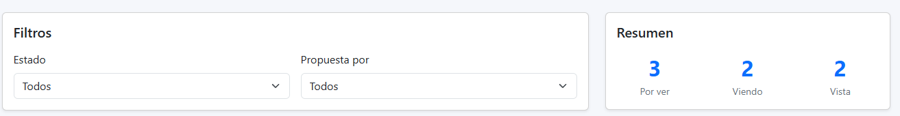

### Experimento: guardar los conteos en useState

Al guardar los conteos en un `useState` inicializado con `seriesIniciales`, el resumen permanece en 2, 1 y 2 aunque cambien las series. Esto ocurre porque los conteos no se recalculan automáticamente.

La solución es calcular `conteos` directamente a partir de `series`, como estado derivado.

### Preguntas

**1. ¿Por qué el valor de los filtros se guarda en App y no dentro de Filtros?**

Porque tanto `Filtros` como `ListaSeries` necesitan esa información. Al guardar el estado en `App`, ambos componentes pueden compartirlo mediante props.

**2. ¿Cómo le avisa Filtros a App que el usuario eligió otra opción?**

Mediante las funciones `onCambiarEstado` y `onCambiarMiembro`, que recibe por props y ejecuta desde `onChange`.

**3. ¿Por qué visibles y conteos no son useState?**

Porque son valores derivados que se calculan a partir de las series y los filtros existentes. No necesitan almacenarse como estados independientes.

**4. ¿Por qué el resumen no cambia cuando se filtra?**

Porque los conteos se calculan utilizando todas las series, no únicamente las visibles. Solo cambian cuando se agregan, eliminan o modifican series.

**5. ¿Qué pasaría si quitar usara visibles en lugar de series?**

Se actualizaría el estado utilizando solamente las series filtradas, lo que provocaría que las series ocultas por los filtros desaparecieran del arreglo principal.

## 6. Formulario para agregar una serie

### Evidencia

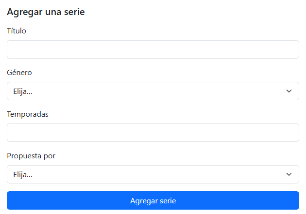

### Experimento: ¿qué pasa si se olvida ...datos?

Al utilizar `setDatos({ [name]: value })` en lugar de `setDatos({ ...datos, [name]: value })`, se pierden los valores de los demás campos porque el objeto completo es reemplazado.

Esto puede generar advertencias sobre campos controlados y errores al validar propiedades que dejaron de existir. La solución es conservar `...datos` para mantener los valores anteriores.

### Preguntas

**1. ¿Qué hace que el formulario sea controlado?**

Los campos reciben sus valores desde el estado de React y los actualizan mediante `onChange`.

**2. ¿Cómo sabe la función cambiar qué campo debe actualizar?**

Utiliza `event.target.name` para identificar el campo y `event.target.value` para obtener su nuevo valor.

**3. ¿Qué pasa si se borra event.preventDefault()?**

El navegador realiza el envío tradicional del formulario y recarga o navega la página, interrumpiendo el manejo del envío mediante React.

**4. ¿Cómo se logra que cada mensaje de error aparezca debajo de su campo?**

Se guardan los errores en un objeto y se muestra el mensaje correspondiente debajo de cada campo utilizando `invalid-feedback` de Bootstrap.

**5. ¿Por qué el id y el estado «Por ver» se ponen en App y no en el formulario?**

Porque `App` administra la lista de series y se encarga de crear cada registro con su identificador y estado inicial. El formulario solamente recopila y valida los datos.

**6. Al agregar una serie, el resumen y los filtros se actualizaron sin tocarlos. ¿Por qué?**

Porque dependen del estado de las series. Cuando cambia la lista, React vuelve a renderizar los componentes y recalcula los valores derivados.

## 7. Estructura del proyecto del API

### Evidencia

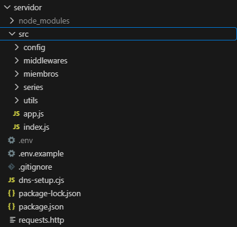

### Reflexiona

**1. ¿Por qué React no puede conectarse directamente a MongoDB y hace falta un API?**

Porque expondría las credenciales de la base de datos en el navegador. El API permite acceder a MongoDB desde el servidor de forma segura.

**2. ¿Por qué se trasladó el proyecto React a una carpeta madre? ¿Cambió algo de su configuración?**

Para organizar el cliente y el servidor dentro del mismo proyecto. No fue necesario modificar la configuración de React.

**3. ¿Qué hacen --env-file y --watch en el comando dev?**

`--env-file` carga las variables de entorno desde `.env` y `--watch` reinicia el servidor automáticamente cuando se modifican sus archivos.

**4. ¿Qué diferencia hay entre .env y .env.example? ¿Cuál se sube a GitHub y por qué?**

`.env` contiene la configuración real y puede incluir credenciales privadas. `.env.example` sirve como plantilla sin secretos y es el que se sube a GitHub.

**5. ¿Qué es un módulo del API? ¿Por qué series tiene un archivo más que miembros?**

Es un conjunto de archivos que implementa una funcionalidad. `series` tiene un archivo adicional para validar los datos recibidos al crear o modificar registros.

**6. Usando el restaurante, explique qué hará cada capa: routes, controller, service y repository.**

- `routes`: el mesero recibe el pedido y lo dirige.
- `controller`: registra el pedido y prepara la respuesta.
- `service`: el chef aplica las reglas para preparar el pedido.
- `repository`: la despensa permite consultar y guardar los ingredientes, que representan los datos.

## 8. El API escuchando peticiones

### Evidencia

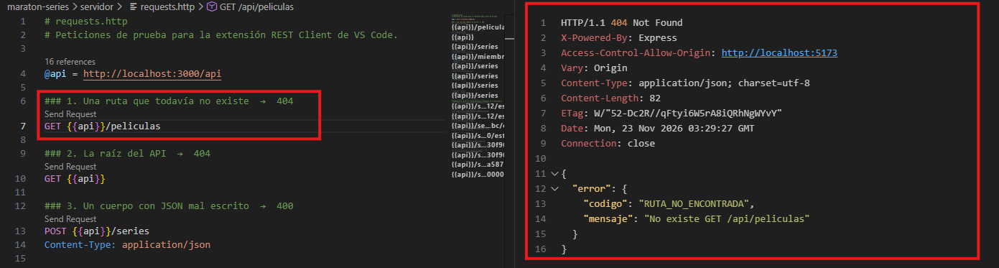

### Experimento: variable de entorno faltante

Al comentar `CLIENT_ORIGIN` en `.env`, el API no inicia y muestra `Error: Falta la variable de entorno CLIENT_ORIGIN`. Al restaurar la variable, el servidor puede iniciar normalmente.

### Explique el recorrido

| # | Pieza | Qué hace con la petición 3 |
|---|---|---|
| 1 | `app.listen` (`index.js`) | Inicia el servidor en el puerto configurado. |
| 2 | `cors` | Configura los permisos para el origen de React. |
| 3 | `express.json()` | Detecta el JSON mal formado y genera un error. |
| 4 | `rutaNoEncontrada` | No se ejecuta porque Express salta al manejador de errores. |
| 5 | `manejarErrores` | Responde 400 con el código `JSON_INVALIDO`. |

### Reflexiona

**1. ¿Qué diferencia hay entre una petición y una respuesta? ¿Cuáles son las partes de cada una?**

La petición es enviada por el cliente e incluye método, URL, encabezados y, opcionalmente, cuerpo. La respuesta la envía el servidor e incluye código de estado, encabezados y cuerpo.

**2. ¿Por qué rutaNoEncontrada usa next(new HttpError(…)) en lugar de responder directamente?**

Para enviar el error al middleware centralizado y mantener un formato de respuesta uniforme.

**3. ¿Cómo sabe Express que manejarErrores es un manejador de errores?**

Porque recibe cuatro parámetros: `err`, `req`, `res` y `next`.

**4. ¿Por qué cors va primero y manejarErrores de último en app.js?**

`cors` debe aplicar los permisos desde el inicio. `manejarErrores` va al final para capturar los errores de los middlewares y rutas anteriores.

**5. ¿Para quién es codigo y para quién es mensaje? ¿Para qué servirá detalles?**

`codigo` permite al cliente identificar el tipo de error; `mensaje` ofrece una explicación legible y `detalles` permite indicar errores específicos, como campos inválidos.

**6. ¿Por qué, en un error 500, el API no le envía al cliente el detalle técnico?**

Para evitar exponer información interna del servidor que podría representar un riesgo de seguridad.

## 9. Conectar el API con MongoDB

### Evidencia

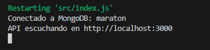

### Experimentos

**6.1. Contraseña incorrecta**

Al modificar la contraseña de `MONGODB_URI`, la autenticación falla y aparece `MongoServerError: bad auth : authentication failed`. El API no llega a iniciar.

**6.2. Dirección del clúster incorrecta**

Al modificar la dirección del clúster, aparece `querySrv ENOTFOUND`, porque no se encuentra el servidor indicado. El API tampoco inicia.

Después de las pruebas, se restaura la cadena de conexión original.

### Explique el arranque

| # | Archivo y línea | Qué ocurre |
|---|---|---|
| 1 | `package.json` · script dev | Ejecuta Node.js, carga `.env` y activa `--watch`. |
| 2 | `config/env.js` | Lee y valida las variables de entorno. |
| 3 | `config/db.js` · `new MongoClient` | Crea el cliente de MongoDB sin conectarse todavía. |
| 4 | `index.js` · `await conectar()` | Espera a que se establezca la conexión con MongoDB. |
| 5 | `config/db.js` · `cliente.db(…)` | Selecciona la base de datos `maraton`. |
| 6 | `index.js` · `app.listen` | Inicia el servidor HTTP después de conectarse correctamente. |

### Reflexiona

**1. ¿Por qué el API se conecta a MongoDB una sola vez y no en cada petición?**

Para reutilizar la conexión y evitar el costo de establecer una nueva en cada solicitud.

**2. ¿Qué hace await conectar() y qué pasaría si se escribiera sin await?**

Espera a que termine la conexión antes de continuar. Sin `await`, el API podría comenzar a recibir peticiones sin tener la base de datos disponible.

**3. En el experimento 6.1, ¿por qué no apareció «API escuchando»?**

Porque falló la autenticación con MongoDB y no se llegó a ejecutar `app.listen`.

**4. ¿Qué comprueba el mensaje «Conectado a MongoDB» y qué no comprueba?**

Confirma que se estableció la conexión con el clúster. No garantiza que existan las colecciones ni que las consultas posteriores funcionen correctamente.

**5. ¿Qué controla Database Access y qué controla Network Access?**

`Database Access` administra los usuarios y permisos de MongoDB. `Network Access` controla qué direcciones IP pueden conectarse al clúster.

**6. ¿Para qué servirá obtenerDb() en la siguiente etapa?**

Para que los repositorios puedan acceder a la base de datos y realizar consultas sin crear nuevas conexiones.

## 10. El primer módulo: miembros

### Evidencia

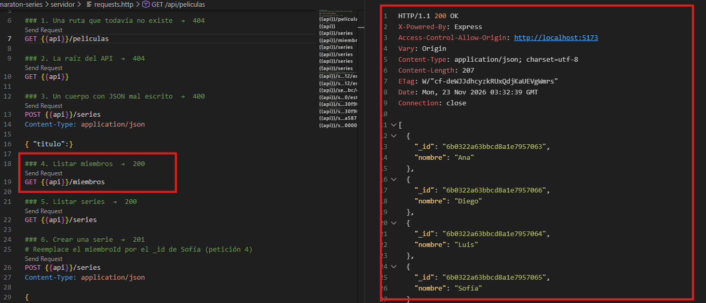

### Experimentos

**7.1. Olvidar `toArray()` en el repositorio**

Al eliminar `toArray()`, el repositorio devuelve un cursor en lugar de un arreglo. Al intentar convertirlo a JSON, el API responde 500 (`ERROR_INTERNO`).

**7.2. Olvidar `await` en el controlador**

Sin `await`, el controlador devuelve una promesa en lugar de esperar los datos. La respuesta es 200, pero contiene `{}` en vez de la lista de miembros.

### Explique el recorrido

| # | Pieza | Qué hace con la petición |
|---|---|---|
| 1 | `app.js` · `app.use('/api/miembros', …)` | Dirige la petición al módulo de miembros. |
| 2 | `miembros.routes.js` | Asocia GET `/` con el controlador `listar`. |
| 3 | `miembros.controller.js` | Solicita la lista al servicio. |
| 4 | `miembros.service.js` | Solicita los datos al repositorio. |
| 5 | `miembros.repository.js` | Consulta la colección con `find`, proyección, orden y `toArray()`. |
| 6 | MongoDB | Devuelve los documentos encontrados. |
| 7 | De vuelta: `miembros.controller.js` | Envía el arreglo como JSON con estado 200. |

### Reflexiona

**1. ¿Qué pregunta responde cada una de las cuatro capas?**

`routes`: qué función atiende la petición; `controller`: qué responder; `service`: qué reglas aplicar; `repository`: cómo consultar los datos.

**2. ¿Por qué existe el servicio si para listar no hay reglas?**

Para mantener la separación de responsabilidades y permitir agregar reglas de negocio posteriormente.

**3. ¿Por qué en el router la ruta es '/' y no '/api/miembros'?**

Porque `app.js` ya establece el prefijo `/api/miembros`. El router define únicamente la ruta relativa.

**4. ¿Qué es un cursor y qué pasó en el experimento 7.1?**

Un cursor permite recorrer los resultados de MongoDB. Sin `toArray()`, se intentó enviar el cursor como JSON y se produjo un error 500.

**5. ¿Por qué el experimento 7.2 respondió 200 si estaba mal?**

Porque no se produjo una excepción. Express convirtió la promesa en `{}`, aunque los datos enviados eran incorrectos.

**6. ¿Por qué POST /api/miembros responde 404 si la dirección es la misma que la del GET?**

Porque las rutas se identifican por método HTTP y dirección. Solo se implementó GET, no POST.

## 11. Series: listar y crear

### Evidencias

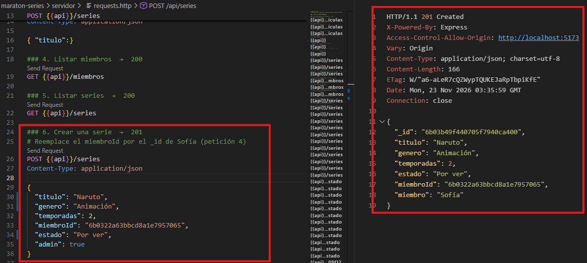

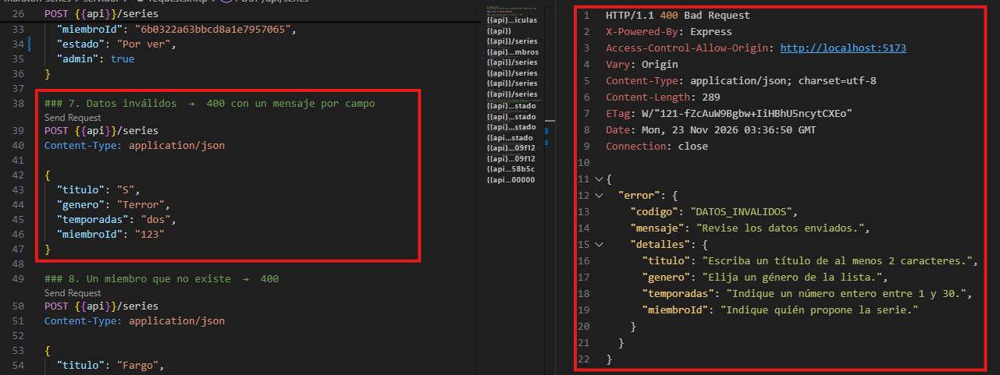

### Experimento: un $lookup mal escrito

Al cambiar `from: 'miembros'` por `from: 'miembro'`, el API responde `200 OK` con un arreglo vacío (`[]`). Esto ocurre porque `$lookup` no encuentra la colección y `$unwind` descarta las series sin miembro relacionado.

Al restaurar el nombre correcto, vuelven a aparecer las series.

### Explique el recorrido del POST

| # | Pieza | Qué hace con la petición |
|---|---|---|
| 1 | `express.json()` | Convierte el cuerpo JSON en un objeto JavaScript. |
| 2 | `series.routes.js` | Dirige POST `/` al controlador `crear`. |
| 3 | `series.controller.js` · crear | Recibe los datos y solicita su creación al servicio. |
| 4 | `series.validacion.js` | Comprueba título, género, temporadas y miembroId. |
| 5 | `miembros.service.js` · existe | Verifica que el miembro indicado exista. |
| 6 | `series.service.js` · repositorio.crear | Prepara los datos válidos y solicita guardarlos en MongoDB. |
| 7 | `series.repository.js` · buscarPorId | Recupera la serie creada con los datos del miembro. |
| 8 | `series.controller.js` · res.status(201) | Devuelve la serie creada con estado HTTP 201. |

**¿Dónde se detiene la petición 8?**

Se detiene en la fila 5 porque el miembro no existe. El servicio genera el error y el middleware `manejarErrores` escribe la respuesta HTTP 400.

### Reflexiona

**1. ¿Por qué series pregunta a miembros.service y no a miembros.repository?**

Porque los módulos deben comunicarse mediante sus servicios, sin acceder directamente a los repositorios de otros módulos.

**2. ¿Por qué se valida en el servidor si el formulario de React también valida?**

Porque las peticiones pueden enviarse sin utilizar React. El servidor debe garantizar que los datos sean correctos.

**3. ¿Qué pasaría si el servicio guardara req.body tal cual con insertOne(datos)?**

Se podrían guardar campos no autorizados, como `admin`, o permitir que el cliente establezca directamente el estado de la serie. Por eso se construye un objeto con los campos permitidos.

**4. ¿Por qué se convierte miembroId con new ObjectId(…) antes de guardar?**

Porque MongoDB utiliza `ObjectId` para identificar los documentos relacionados y el esquema espera ese tipo de dato.

**5. ¿Qué hace cada etapa de CON_MIEMBRO? ¿Qué demostró el experimento de la Actividad 8?**

`$lookup` relaciona las series con los miembros, `$unwind` convierte el arreglo resultante en un objeto y `$project` selecciona los campos de la respuesta. El experimento demostró que un nombre incorrecto en `$lookup` puede producir una lista vacía sin generar un error HTTP.

**6. ¿Por qué crear responde 201 y con la serie leída de la base, y no con los datos que llegaron?**

Porque 201 indica que se creó un recurso. Al leerlo nuevamente desde MongoDB, la respuesta incluye su identificador, estado inicial y los datos relacionados del miembro.

## 12. Series: cambiar estado y eliminar

### Evidencias

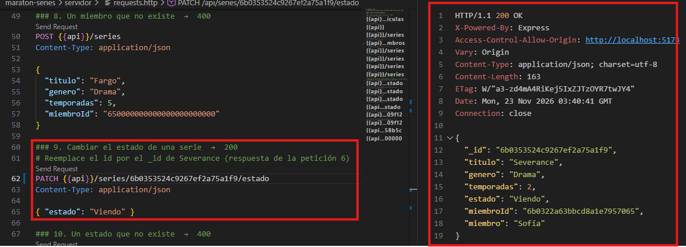

### Experimentos

**8.1. Sin revisarId**

Al omitir `revisarId`, un identificador inválido como `abc` llega al repositorio. `new ObjectId('abc')` genera un error y el API responde 500 en lugar de 400.

**8.2. modifiedCount en lugar de matchedCount**

Al utilizar `modifiedCount`, el primer PATCH responde 200, pero al repetirlo con el mismo estado responde 404. Esto ocurre porque la serie existe, aunque no se haya modificado ningún campo.

**8.3. Sin .end()**

Al eliminar `.end()` de `res.status(204).end()`, la serie se elimina de MongoDB, pero REST Client queda esperando una respuesta que nunca se envía.

### Explique el recorrido del PATCH

| # | Pieza | Qué hace con esta petición |
|---|---|---|
| 1 | `app.js` · `/api/series` | Dirige la petición al router de series. |
| 2 | `series.routes.js` · `patch('/:id/estado')` | Identifica la ruta y llama al controlador. |
| 3 | `series.controller.js` · cambiarEstado | Obtiene el identificador y el nuevo estado. |
| 4 | `utils/revisarId.js` | Verifica que el identificador tenga un formato válido. |
| 5 | `series.validacion.js` · validarEstado | Comprueba que el estado sea permitido. |
| 6 | `series.repository.js` · cambiarEstado | Actualiza el documento mediante `$set` y comprueba `matchedCount`. |
| 7 | `series.repository.js` · buscarPorId | Recupera la serie con su estado actualizado. |
| 8 | `series.controller.js` · res.json | Devuelve la serie actualizada con HTTP 200. |

**¿Dónde se detienen las peticiones incorrectas?**

- Petición 11: fila 4, identificador inválido. Responde 400 (`ID_INVALIDO`).
- Petición 10: fila 5, estado inválido. Responde 400 (`DATOS_INVALIDOS`).
- Petición 12: fila 6, serie inexistente. Responde 404 (`NO_ENCONTRADA`).

### Reflexiona

**1. ¿Por qué el id va en la dirección y el estado nuevo en el cuerpo?**

Porque el identificador indica qué serie modificar y el cuerpo especifica el dato que se desea cambiar.

**2. ¿Qué diferencia hay entre responder 400 ID_INVALIDO y 404 NO_ENCONTRADA? ¿Quién detecta cada uno?**

400 indica que el identificador tiene un formato incorrecto y lo detecta `revisarId`. 404 indica que el identificador es válido, pero la serie no existe; lo detecta el servicio después de consultar el repositorio.

**3. ¿Por qué revisarId está en utils y no en la carpeta series?**

Porque es una función reutilizable que puede utilizarse en otros módulos.

**4. ¿Qué demostró el experimento 8.2 sobre matchedCount y modifiedCount?**

Que `matchedCount` indica si el documento existe, mientras que `modifiedCount` indica si realmente cambió algún valor.

**5. En el experimento 8.3, la serie se borró aunque REST Client no recibió respuesta. ¿Qué problema causaría esto en React?**

React podría mostrar un error o permanecer esperando, aunque la serie ya se haya eliminado. Esto produciría una diferencia entre la interfaz y la base de datos.

**6. ¿Por qué el segundo DELETE a la misma serie responde 404? ¿En qué situación real pasaría?**

Porque el documento ya fue eliminado. Podría ocurrir si dos usuarios intentan eliminar la misma serie o si se repite una solicitud de eliminación.

## 13. React lee el API

### Evidencia

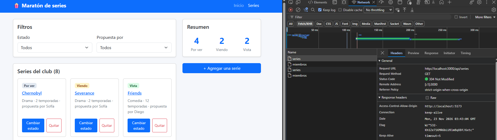

### Experimentos

| Experimento | Resultado esperado |
|---|---|
| 9.1. Servidor apagado | Aparece una alerta de conexión y `ERR_CONNECTION_REFUSED` en la consola. |
| 9.2. CORS: React en el puerto 5174 | El navegador bloquea las respuestas porque el API solo autoriza el origen 5173. |
| 9.3. Variable sin `VITE_` | La URL contiene `undefined/series` y se produce un error al intentar interpretar HTML como JSON. |
| 9.4. `useEffect` sin `[]` | Se generan peticiones repetidas porque cada actualización del estado vuelve a ejecutar el efecto. |

### Explique el recorrido

| # | Pieza | Qué hace |
|---|---|---|
| 1 | App · primer dibujo | Inicializa los estados y muestra el indicador de carga. |
| 2 | useEffect · cargar() | Ejecuta la carga de series y miembros al montar el componente. |
| 3 | seriesApi.js · obtenerSeries → pedir | Construye la URL y realiza la petición mediante `fetch`. |
| 4 | API · GET /api/series | Express consulta MongoDB y devuelve las series en JSON. |
| 5 | seriesApi.js · respuesta.json() | Convierte la respuesta JSON en datos de JavaScript. |
| 6 | App · setSeries y setMiembros | Guarda los datos recibidos en el estado de React. |
| 7 | App · finally | Desactiva el indicador de carga, incluso si ocurre un error. |
| 8 | App · segundo dibujo | Muestra las tarjetas y los miembros disponibles en los filtros. |

**Experimento 9.1:** el recorrido falla en la fila 3, durante `fetch`, porque el servidor no responde. La página muestra una alerta de conexión.

**Experimento 9.3:** el problema también aparece en la fila 3, al construir una URL incorrecta. La petición llega a Vite y falla al interpretar la respuesta como JSON en la fila 5.

**1. ¿Por qué la dirección del API va en un .env y no escrita en seriesApi.js?**

Para poder cambiar la dirección del servidor sin modificar el código fuente.

**2. ¿Por qué no se pueden poner secretos en una variable VITE_?**

Porque Vite incorpora esas variables al código JavaScript que recibe el navegador, donde cualquier usuario puede consultarlas.

**3. ¿Qué diferencia hay entre el error del experimento 9.1 y el del 9.2, si la página muestra el mismo mensaje? ¿Dónde se nota?**

En el 9.1 el servidor está apagado y rechaza la conexión. En el 9.2 el servidor responde, pero CORS bloquea el acceso. La diferencia se observa en la consola del navegador.

**4. ¿Por qué la petición va dentro de useEffect? ¿Qué demostró el experimento 9.4?**

Para ejecutar la carga al montar el componente. El experimento demostró que omitir `[]` puede provocar peticiones repetidas después de cada renderizado.

**5. ¿Por qué setCargando(false) va en finally?**

Porque debe finalizar el estado de carga tanto si la petición funciona como si ocurre un error.

**6. Al agregar una serie y recargar, la serie desaparece. ¿Qué tendría que hacer agregar para que no pase?**

Enviar la nueva serie al API mediante POST y actualizar el estado solamente después de que MongoDB confirme que se guardó.

## 14. El formulario crea con POST

### Evidencia

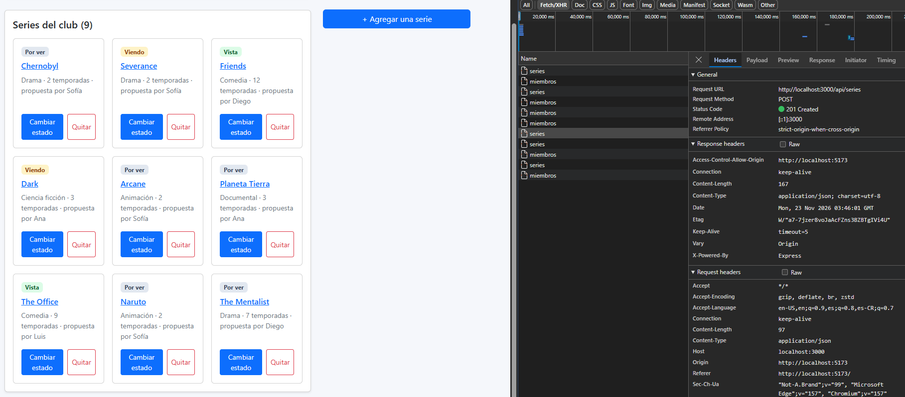

### Experimentos

**7.1. Sin validación del navegador**

Al omitir la validación local, el formulario envía datos vacíos. El API responde 400 y muestra los errores debajo de los campos.

**7.2. Sin Content-Type**

El servidor no interpreta el cuerpo como JSON y devuelve errores de validación para los cuatro campos, aunque los datos enviados sean correctos.

**7.3. Sin JSON.stringify**

El objeto se envía como `[object Object]` y el API responde 400 (`JSON_INVALIDO`).

**7.4. Sin await**

El formulario se limpia antes de confirmar la creación. Si el servidor está apagado, el error aparece en la consola y no se muestra correctamente al usuario.

### Explique el recorrido

| # | Pieza | Qué hace |
|---|---|---|
| 1 | `FormularioSerie` · validarSerie | Comprueba los datos antes de enviarlos. |
| 2 | `FormularioSerie` · setEnviando(true) | Desactiva el botón mientras se guarda. |
| 3 | `App` · agregar | Llama al API y espera la respuesta. |
| 4 | `seriesApi` · crearSerie → pedir | Envía la petición POST con los datos en JSON. |
| 5 | API · POST /api/series | Valida y guarda la serie en MongoDB. |
| 6 | `App` · setSeries | Agrega al estado la serie confirmada por el API. |
| 7 | `FormularioSerie` · setDatos(VACIO) | Limpia el formulario después de guardar. |
| 8 | `FormularioSerie` · finally | Reactiva el botón de envío. |

**¿Qué ocurre si el API responde 400?**

El recorrido se desvía después de la fila 5. El error llega al `catch` del formulario, que muestra los mensajes de validación debajo de los campos. No se agrega la serie ni se limpia el formulario.

### Reflexiona

**1. ¿Qué tres piezas necesita fetch para enviar datos? ¿Qué demostraron los experimentos 7.2 y 7.3?**

Necesita `method`, `headers` y `body`. Los experimentos demostraron que `Content-Type` permite interpretar el cuerpo como JSON y `JSON.stringify` convierte los datos al formato correcto.

**2. ¿Por qué agregar llama primero al API y después a setSeries?**

Para mostrar únicamente las series que fueron guardadas correctamente en MongoDB.

**3. ¿Por qué agregar no tiene try/catch?**

Para permitir que el error llegue al formulario, donde se muestran los mensajes correspondientes.

**4. ¿Por qué el formulario envía el miembroId y no el nombre?**

Porque el API utiliza el identificador para comprobar que el miembro existe y establecer la relación en MongoDB.

**5. Si el navegador ya valida, ¿por qué el API valida otra vez?**

Porque las validaciones del navegador pueden omitirse. El API debe proteger la integridad de los datos.

**6. ¿Qué problema mostró el experimento 7.4?**

Que sin `await` el formulario continúa ejecutándose antes de recibir la respuesta, pudiendo perder los datos ingresados y dejar errores sin manejar.

## 15. Cambiar estado y quitar desde React

### Evidencia

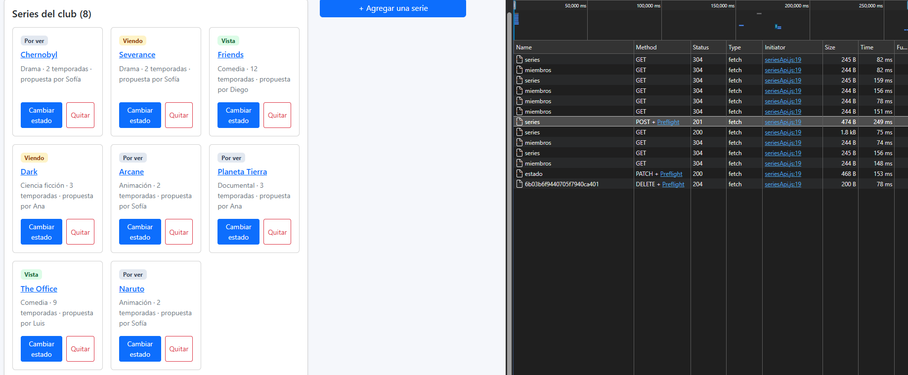

### Experimentos

**4.1. Dos pestañas**

Al eliminar una serie en una pestaña e intentar eliminarla desde otra sin recargar, el API responde 404 porque la serie ya no existe. React muestra la alerta correspondiente.

**4.2. Servidor apagado**

Si el API está apagado, la tarjeta permanece visible y aparece un error. Al actualizar la pantalla antes de esperar al API, la tarjeta desaparece temporalmente, pero vuelve al recargar porque no se eliminó de MongoDB.

**4.3. Sin el caso 204**

Al omitir la comprobación del estado 204, `respuesta.json()` intenta interpretar una respuesta vacía y genera `Unexpected end of JSON input`, aunque la serie fue eliminada correctamente.

**4.4. La lista vieja**

Al utilizar `setSeries(series.filter(...))`, dos eliminaciones consecutivas pueden utilizar una lista desactualizada y hacer reaparecer una tarjeta. Con `setSeries((actuales) => ...)` se utiliza el estado vigente.

### Explique el recorrido de Quitar

| # | Pieza | Qué hace |
|---|---|---|
| 1 | `TarjetaSerie` · botón Quitar | Ejecuta `onQuitar` con el identificador. |
| 2 | `App` · quitar | Llama al API y espera la eliminación. |
| 3 | `seriesApi` · eliminarSerie → pedir | Envía DELETE con el identificador. |
| 4 | API · series.routes → controller | Recibe la petición y llama al servicio. |
| 5 | API · series.service · eliminar | Valida el identificador y comprueba el resultado. |
| 6 | API · series.repository · deleteOne | Elimina el documento de MongoDB. |
| 7 | `seriesApi` · pedir (respuesta 204) | Reconoce la respuesta sin cuerpo y devuelve `null`. |
| 8 | `App` · setSeries | Elimina la tarjeta del estado de React. |

**¿Dónde se detiene el recorrido?**

- Experimento 4.1: fila 5, porque el servicio detecta que la serie no existe y devuelve 404.
- Experimento 4.3: fila 7, porque falla la lectura de JSON en una respuesta vacía.

### El mapa del Maratón completo

| En la pantalla | Función de seriesApi | Ruta del API | Función del repositorio |
|---|---|---|---|
| Abrir la página | `obtenerSeries` | GET

## 16. React Router: varias páginas

### Evidencia

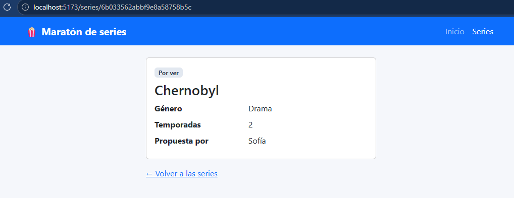

### Experimentos

**10.1. Usar `<a href>` en lugar de Link**

El navegador solicita nuevamente el documento HTML y reinicia React. Con `Link`, la navegación ocurre sin recargar la página.

**10.2. Sin Outlet**

Al eliminar `Outlet` del diseño compartido, solamente aparece el encabezado porque las páginas hijas no tienen dónde renderizarse.

**10.3. Sin limpieza del efecto**

Sin `AbortController`, las peticiones anteriores pueden completarse y actualizar el estado con información desactualizada. Con la limpieza, se cancela la petición pendiente.

**10.4. Cancelación tratada como error**

Al eliminar el tratamiento especial de `AbortError`, una petición cancelada puede mostrar incorrectamente un mensaje de error de conexión.

**10.5. Colocar la ruta * primero**

La navegación continúa funcionando porque React Router selecciona la ruta más específica, independientemente del orden en que se declaren.

### Explique el recorrido

| # | Pieza | Qué hace |
|---|---|---|
| 1 | `TarjetaSerie` · Link | Navega hacia `/series/:id` al seleccionar el título. |
| 2 | `BrowserRouter` | Actualiza la dirección mediante la API de historial sin recargar. |
| 3 | `App` · Routes | Selecciona la ruta correspondiente al detalle. |
| 4 | `Layout` · Outlet | Renderiza la página de detalle dentro del diseño compartido. |
| 5 | `DetalleSerie` · useParams | Obtiene el identificador desde la dirección. |
| 6 | `DetalleSerie` · useEffect | Ejecuta la consulta cuando cambia el identificador. |
| 7 | `seriesApi` · obtenerSerie | Envía GET `/api/series/:id`. |
| 8 | API · GET /api/series/:id | Consulta MongoDB y devuelve la serie. |
| 9 | `DetalleSerie` · setSerie | Guarda el resultado y muestra la información. |

<WritingBlock id="81643" variant="standard">**¿Qué cambia con una dirección inexistente?**

- `/peliculas`: React Router muestra la página `NoEncontrada`, sin consultar el API.
- `/series/650000000000000000000000`: la ruta coincide, pero el API responde 404 porque no encuentra la serie.

### Reflexiona

**1. ¿Cómo logra React Router cambiar de página sin pedir otra página al servidor? ¿Qué mostró el experimento 10.1?**

Utiliza la API de historial del navegador y renderiza el componente correspondiente. El experimento mostró que `Link` evita recargar la página, a diferencia de `<a href>`.

**2. ¿Por qué la ruta de Layout no tiene path y qué hace Outlet?**

Porque funciona como ruta de diseño compartido. `Outlet` muestra el componente de la ruta hija seleccionada.

**3. ¿Qué diferencia hay entre el 404 de /peliculas y el de /series/6500…? ¿Quién detecta cada uno?**

El primero lo detecta React Router porque no existe una ruta coincidente. El segundo lo detecta el API porque la serie solicitada no existe en MongoDB.

**4. ¿Por qué el efecto del detalle depende de [id]? ¿Qué pasaría con []?**

Porque debe consultar nuevamente cuando cambia el identificador. Con `[]`, solamente se ejecutaría al montar el componente.

**5. ¿Qué hace la limpieza del efecto y qué mostraron los experimentos 10.3 y 10.4?**

Cancela las peticiones pendientes mediante `AbortController`. Los experimentos demostraron que evita respuestas desactualizadas y que una cancelación no debe tratarse como error de conexión.

**6. ¿Qué se gana al guardar los filtros en la dirección? ¿Cómo se usaría lo mismo para paginar?**

Permite compartir enlaces con filtros aplicados y conservarlos al recargar. Para paginar se podría agregar un parámetro como `?page=2`.

## 17. Del documento a la tabla: EF Core y SQL Server

### Evidencia

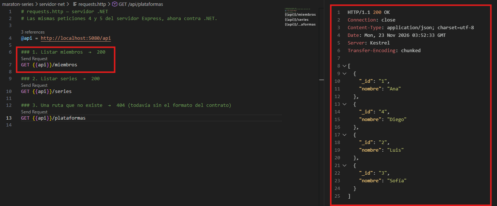

### Experimentos

**12.1. Clave foránea inexistente (E1)**

Al intentar insertar una serie con un `MiembroId` inexistente, SQL Server rechaza la operación por incumplir la restricción de clave foránea.

**12.2. Correo duplicado (E2)**

Al insertar dos miembros con el mismo correo, SQL Server rechaza el segundo registro debido al índice único.

**12.3. Estado inválido (E3)**

Al insertar una serie con un estado no permitido, SQL Server rechaza el registro por la restricción `CHECK`.

**12.4. Eliminar un miembro con series (E4)**

SQL Server impide eliminar un miembro que todavía tiene series relacionadas cuando la relación está configurada con borrado restringido.

**12.5. Modificar el modelo sin migración**

Los cambios realizados en las entidades no se aplican automáticamente a la base. EF Core detecta que existen diferencias pendientes y exige crear una migración antes de actualizarla.

**12.6. Reconstruir la base desde cero**

Al ejecutar `dotnet ef database drop --force`, se elimina la base de datos. Posteriormente, `dotnet ef database update` aplica nuevamente las migraciones `Inicial` y `GenerosFavoritos`, recuperando las tablas y los datos iniciales.

### Explique el recorrido

| # | Pieza | Qué hace |
|---|---|---|
| 1 | Kestrel (puerto 5080) | Recibe la petición HTTP GET. |
| 2 | `app.MapGet("/api/series", …)` | Ejecuta el endpoint correspondiente. |
| 3 | Inyección de dependencias · `AddDbContext` | Proporciona una instancia de `MaratonContext`. |
| 4 | `user-secrets` · `ConnectionStrings:Maraton` | Proporciona la configuración de conexión a SQL Server. |
| 5 | LINQ · `OrderBy` y `Select` | Define el orden y los campos que devolverá la consulta. |
| 6 | EF Core · `ToListAsync` | Ejecuta la consulta y obtiene los resultados. |
| 7 | SQL Server · SELECT con JOIN | Consulta las tablas relacionadas y devuelve los registros. |
| 8 | Objetos anónimos → JSON | ASP.NET Core serializa los resultados y responde 200. |

### Correspondencia con MongoDB

| MongoDB | SQL Server |
|---|---|
| Correo único | Índice único en `Miembros.Correo` |
| `miembroId` | Clave foránea `Series.MiembroId` |
| Enum de estado | Restricción `CHECK` en `Series.Estado` |
| Arreglo `generosFavoritos` | Tabla intermedia `MiembroGeneros` |

### Reflexiona

<WritingBlock id="81743" variant="standard">**1. ¿Qué garantiza una clave foránea que MongoDB no garantizaba con miembroId? ¿Qué mostraron los experimentos E1 y E4?**

Garantiza que el miembro relacionado exista y protege la integridad referencial. E1 impide insertar una referencia inexistente y E4 impide eliminar un miembro con series relacionadas.

**2. ¿Por qué generosFavoritos necesita una tabla aparte en SQL Server?**

Porque representa una relación muchos a muchos entre miembros y géneros. Se utiliza `MiembroGeneros` para almacenar las relaciones.

**3. ¿Por qué las migraciones se suben al repositorio y la cadena de conexión no? ¿Dónde vive cada una?**

Las migraciones se versionan en `Migrations` para reconstruir la base. La cadena de conexión se guarda en `user-secrets` para proteger las credenciales.

**4. ¿Qué hizo EF Core con el Select de C#? ¿Qué SQL vio en la terminal?**

Tradujo la proyección LINQ a una consulta SQL con `SELECT`, `INNER JOIN` y `ORDER BY`, devolviendo únicamente los campos solicitados.

**5. ¿Qué pasó en el experimento 12.5 y por qué EF Core se negó a actualizar la base?**

Detectó que el modelo cambió respecto a la última migración y generó `PendingModelChangesWarning`. Es necesario crear una nueva migración para aplicar el cambio.

**6. Si el cliente de React apuntara a este servidor, ¿qué tendría que cambiar en React? ¿Por qué?**

La variable `VITE_API_URL` debería apuntar al servidor .NET. Como ambos API utilizan el mismo contrato JSON, las consultas GET pueden reutilizarse. Las operaciones de escritura requieren que .NET implemente también sus endpoints.